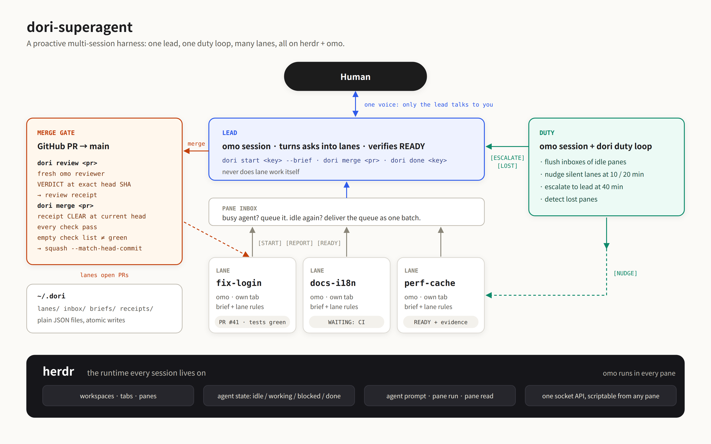
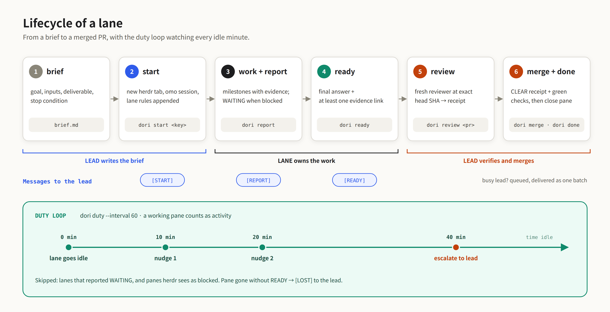

<p align="center">
  
</p>

# dori-superharness-exp

一个主动式的多会话编码代理 harness，约 660 行 TypeScript，运行在 [herdr](https://github.com/herdrdev/herdr) 和 [omo](https://github.com/code-yeongyu/oh-my-openagent) 之上。

[English](README.md) | [한국어](README.ko.md) | 简体中文 | [日本語](README.ja.md)

只有一个 lead 会话和你对话。每个任务作为一条 lane 运行：在自己的 herdr 标签页里跑一个独立的 omo 会话，从一份写好的 brief 开始，以一条必须附带证据的 READY 结束。duty 循环会提醒长时间没动静的 lane，把问题上报给 lead，并把发给忙碌 pane 的消息先存着，等它能读的时候再送达。合并要经过一道门：精确 head 上的 CLEAR 评审回执，加上全绿的检查。

## 为什么有这个仓库

DeepSeek 发布了 [dsh-superagent-prototype](https://github.com/deepseek-ai/dsh-superagent-prototype)（首次提交 2026-10-31），大约一天后又发表了文章 "Exploring Super-agent Design: Towards a More Autonomous Agent System"。他们的设计是：一个长期存活、只和人对话并负责分派工作的 Router 会话；彼此隔离、每个 ticket 一个的 Worker 会话；按轮次批量送达的事件触发；以及一个 watchdog。他们的 README 称之为研究原型，宣称的理念是 "take as little human attention as possible, and give as much value as possible"。

同样的结构，我们已经公开跑了大约六个月：

- 2026-04-18：团队模式合入 omo，多个代理会话各占一个终端 pane，各有自己的 worktree（[f1268c0](https://github.com/code-yeongyu/oh-my-openagent/commit/f1268c0)、[e303fee](https://github.com/code-yeongyu/oh-my-openagent/commit/e303fee)）。
- 2026-05-06：Dori 这个名字进入 omo 的 README（[#3807](https://github.com/code-yeongyu/oh-my-openagent/pull/3807)）。
- 2026-10-07：本仓库以 `omo-dori-mode-experimental` 之名发布 Dori 模式（[ce53e4d](https://github.com/sisyphuslabs/dori-superharness-exp/commit/ce53e4d)）：一个代理把每项工作交给 herdr 标签页里独立的代理会话，只在工作完成后才关闭它。git 历史是公开的。
- 2026-10-31：DeepSeek 原型的首次提交。
- 2026-11-01 前后：DeepSeek 的文章。

这就是我们每天的工作方式。omo 有 70k+ star。2026-10-03 到 2026-11-02 这 31 天里，[作者的 GitHub 贡献日历](https://github.com/code-yeongyu)记录了 38,656 次贡献：平均每天约 1,250 次，峰值是 2026-10-16 的 2,227 次和 2026-10-29 的 2,001 次。也就是每天最多约 2,000 次贡献，由这套设置的完整版本产出。

仓库根目录的 harness 是它的最小版本：只保留在 herdr 和 omo 上跑起来所需要的部分，别的都没接。

## 架构



三个角色，每个都是 herdr pane 里的一个 omo 会话。herdr 提供工作区、标签页和 pane，把 pane 里的 omo 识别为代理，并通过 CLI 报告它的状态（idle、working、blocked、done）。dori 对 pane 做任何事之前，先读这个状态。

lead 是唯一和你对话的会话。它把请求写成 brief，用 `dori start` 打开 lane，读取 lane 发回的内容，并执行合并。

一条 lane 是自己 herdr 标签页里的一个 omo 会话，从一份 brief 加上附在后面的 lane 规则（`prompts/lane-footer.md`）启动。它用 `dori report` 汇报阶段进展，用 `dori ready` 结束，而 `dori ready` 没有证据链接就会拒绝发出。

duty 循环是 `dori duty --interval 60`，一个普通进程，跑在 duty omo 会话旁边的 pane 里。每一轮它把排队的消息送进已变为 idle 的 pane，提醒没动静的 lane，向 lead 上报，并把 pane 消失的 lane 标记为 lost。

状态是 `~/.dori`（或 `$DORI_HOME`）下的 JSON 文件：`lanes/`、`inbox/`、`briefs/`、`receipts/`。harness 唯一新增的常驻进程是 duty 循环，唯一的运行时依赖是 Bun。



`dori start <key> --brief FILE` 把 brief 和 lane 规则写到 `~/.dori/briefs/<key>.md`，打开一个标签页，运行 `omo 'Read your brief at <path> and execute it. Your lane key is <key>.'`，把 lane 记为 `working`，并给 lead 发送 `[START <key>]`。之后 lane 汇报进展（`[REPORT <key>]`，被 pane 之外的东西卡住时是 `[REPORT <key> WAITING]`），最后以带证据链接的 `[READY <key>]` 结束。lead 核对证据，有 PR 时运行 `dori review` 和 `dori merge`，再用 `dori done <key>` 关闭 lane。一直 idle 的 lane 会在 10 分钟和 20 分钟时收到提醒，40 分钟时上报给 lead（`[ESCALATE <key>]`）。在 READY 之前 pane 就消失的 lane 会被报告为 `[LOST <key>]`。

## 与 DeepSeek super-agent 的对应

| DeepSeek super-agent | dori | 在本仓库中 |
|---|---|---|
| Router 会话：和人对话，分派工作 | LEAD 会话：唯一和人对话的会话；打开 lane，执行合并 | `prompts/lead.md`，`src/cli.ts` 中的 `up()` |
| Worker 会话，每个 ticket 一个 | LANE：每个任务一个 omo 会话，有自己的 herdr 标签页和自己的 brief | `src/harness.ts` 中的 `startLane()`，`prompts/lane-footer.md` |
| Ticket + Mandate | brief 文件 + lane 规则页脚，以及必须附带证据的 READY | `~/.dori/briefs/<key>.md`，`src/harness.ts` 中的 `ready()` |
| 触发器批处理：事件按轮次成批送达 | pane 收件箱：发给忙碌 pane 的消息进入队列，等它 idle 时作为一批送达 | `src/harness.ts` 中的 `send()`、`flushInbox()`；`src/store.ts` 中的 `inbox/` |
| Watchdog | DUTY 循环：清空收件箱，10/20 分钟提醒，40 分钟上报，检测消失的 pane | `src/harness.ts` 中的 `dutyTick()`，`prompts/duty.md`，`prompts/nudge.md` |
| 准入矩阵、`maxWorkers`（默认 3） | 这里没有；`dori start` 只拒绝已经打开的 key | `src/harness.ts` 中的 `startLane()` |
| 原型中没有 | 带门的合并：精确 head SHA 上的 CLEAR 评审回执加全绿检查；空的检查列表从不算绿 | `src/harness.ts` 中的 `review()`、`mergeGate()`，`prompts/review.md`，`src/store.ts` 中的 `receipts/` |
| 原型中没有 | 单一声音规则：lane 和 duty 从不和人对话 | `prompts/lead.md`，`prompts/duty.md`，`prompts/lane-footer.md` |
| 原型中没有 | 全文答案账本：每条 lane 的最终答案、证据链接和日志都保存在磁盘上 | `src/store.ts` 中的 `Lane.final`、`Lane.log` |

## 快速开始

你需要 Bun 1.3 或更新版本、herdr、omo，以及 GitHub CLI `gh`（用于读取 PR 的 head SHA、检查状态和执行合并）。

```sh
git clone https://github.com/sisyphuslabs/dori-superharness-exp
cd dori-superharness-exp
bun install
bun link   # 把 `dori` 放到 PATH 上；也可以在下文出现 `dori` 的地方改写成 `bun src/cli.ts`
```

启动 herdr，然后在 shell 里：

```sh
dori up
# UP lead=w1:p1 duty=w1:p2 loop=w1:p3 home=~/.dori
```

这会打开一个名为 `dori` 的 herdr 工作区，带一个 lead pane（system prompt 后附加了 `prompts/lead.md` 的 omo）、一个 duty pane（附加了 `prompts/duty.md` 的 omo），以及它下方的 duty 循环。和 lead pane 对话。它会自己写 brief（目标、输入、交付物、停止条件、约束；见 [`examples/brief.md`](examples/brief.md)）并打开 lane，你也可以在 shell 里做同样的事：

```sh
dori start fix-flaky-login --brief examples/brief.md
# STARTED fix-flaky-login pane=w1:p4 brief=~/.dori/briefs/fix-flaky-login.md
dori status
# lead=w1:p1 duty=w1:p2 home=~/.dori
# fix-flaky-login          working  w1:p4    active 0m ago  start: examples/brief.md
```

lane 的 key 要匹配 `^[a-z][a-z0-9-]{1,40}$`，已经打开的 key 会被拒绝。

在 lane 内部，omo 用 lane 规则交给它的命令汇报和收尾：

```sh
dori report fix-flaky-login --text 'reproduced: 1 failure in 20 runs, shared session fixture'
dori report fix-flaky-login --status waiting --text 'WAITING: checks on owner/repo#12'
dori ready fix-flaky-login --text 'root cause fixed in owner/repo#12, checks green' --evidence https://github.com/owner/repo/pull/12
```

lead 收到 `[READY fix-flaky-login]` 后：

```sh
dori review owner/repo#12            # 固定在 head SHA 上的全新 omo 评审者；写入回执；CLEAR 时 exit 0
dori merge owner/repo#12 --dry-run   # MERGE_OK ...（dry run），或 MERGE_REFUSED <原因> 并 exit 2
dori merge owner/repo#12             # gh pr merge --squash --match-head-commit <sha>
dori done fix-flaky-login            # 关闭 lane 的 pane；只有 READY 的 lane 才能关闭
```

`dori send <lead|duty|key|pane> --text '...'` 把消息送到一个 pane，pane 忙碌时则排队。`dori role <lead|duty> [PANE]` 用于没有使用 `dori up` 时手动注册 pane。省略 `--text` 时从 stdin 读取消息。代理看到的命令在渲染时带有 `src/cli.ts` 的完整路径并设置了 `DORI_HOME`，所以它们的 PATH 上不需要有 `dori`。环境变量：`DORI_HOME`（状态目录，默认 `~/.dori`）、`DORI_AGENT_CMD`（默认 `omo`）、`DORI_HERDR_SESSION`（具名的 herdr 会话）、`DORI_CMD`（告诉代理如何调用 dori）。

## harness 强制执行的规则

只有一个声音。lead 是唯一和你对话的会话（`prompts/lead.md`）。lane 规则要求所有给人看的事实都发给 lead（`prompts/lane-footer.md` 第 3 条），duty 会话从不合并、从不和人对话（`prompts/duty.md`）。lane 做的每件事都以 prompt 的形式到达 lead pane：`[START]`、`[REPORT]`、`[READY]`、`[LOST]`、`[ESCALATE]`。

READY 需要证据。没有至少一个 `--evidence` 链接，或没有最终答案文本，`dori ready` 就会拒绝（`src/harness.ts` 中的 `ready()`）。文本和链接作为 `final` 存在 lane 记录上，而 `dori done` 拒绝任何不是 `ready` 的 lane，所以没有 lane 会在没有记录答案的情况下关闭。

忙碌的 pane 从不被打断。`dori send` 先向 herdr 询问 pane 的代理状态。`idle`、`done` 或普通 shell 立刻收到消息；其他状态下消息进入 `~/.dori/inbox/` 排队，命令打印 `QUEUED`。duty 循环在 pane 变为 idle 时把队列作为一条消息送达，开头是 "N messages arrived while you were busy"（`src/harness.ts` 中的 `send()` 和 `flushInbox()`）。`dori done` 也同样等待：herdr 报告为 working 或 blocked 的 pane，它拒绝关闭。

在 10、20、40 分钟时提醒。`src/harness.ts` 中 `NUDGE_MINUTES = [10, 20, 40]`。10 分钟没有汇报、pane 也不在 working 的 lane，会在自己的 pane 里收到 `prompts/nudge.md`。20 分钟时再收到一次。40 分钟时 duty 循环停止提醒，给 lead 发送 `[ESCALATE <key>]`。`working` 的 pane 会重置 idle 计时，汇报了 `--status waiting` 或 pane 处于 `blocked` 的 lane 不会被打扰，任何新汇报都会把提醒计数归零，消失的 pane 则报告为 `[LOST <key>]`。

合并需要精确 head 上的 CLEAR 回执和全绿检查。`dori merge` 用 `gh` 读取 PR 的 head SHA，然后要求 `~/.dori/receipts/` 里有该 SHA 的、结论为 `CLEAR` 的回执。只有 `dori review` 会写回执。它用固定在该 SHA 上的 `prompts/review.md` 运行一个全新的非交互 omo（`omo -p --no-session`，可选 `--model`），评审者没有打印 `VERDICT:` 行时，就不写回执。接着 `gh pr checks` 必须返回至少一项检查，每项检查都必须是 `pass` 或 `skipping`，且至少有一项是 `pass`。空的检查列表会以 "an empty check list is never green" 被拒绝。合并本身是 `gh pr merge --squash --match-head-commit <sha>`。评审之后再 push 会改变 head SHA，回执不再匹配，合并就会被拒绝（`src/harness.ts` 中的 `review()` 和 `mergeGate()`）。

## Dori 模式（`skills/dori-mode`）

Dori 模式是面向即时通讯的那一半，2026-10-07 在本仓库发布。它把一个编码代理会话变成一个常驻的代理，你通过即时通讯软件和它对话。这个会话把每项工作交给 herdr 标签页里独立的代理会话，为自己启动的每个会话保留一份注册表，只在工作被证明完成后才关闭它：一个已合并的 PR、一个已关闭的 issue、一个已发布的版本，或者一项它能自己运行的检查。它以一个 skill（`skills/dori-mode/SKILL.md` 加 `references/`）和自己的 Bun + TypeScript CLI 的形式发布，CLI 也叫 `dori`。

```sh
curl -fsSL https://raw.githubusercontent.com/sisyphuslabs/dori-superharness-exp/main/install.sh | bash
```

这条命令把本仓库克隆到 `~/.dori/src`，把 skill 链接到 `~/.agents/skills/dori-mode`，用 `bun link` 把 Dori 模式的 `dori` 放到 PATH 上，并把示例配置复制到 `~/.dori/config.json`。命令、配置、路由和 done 协议见 [`skills/dori-mode/SKILL.md`](skills/dori-mode/SKILL.md) 及其 [`references/`](skills/dori-mode/references/)。

harness 和 Dori 模式都提供一个名为 `dori` 的命令。每台机器只安装其中一个，或者用 `bun src/cli.ts` 运行 harness，把 `dori` 留给 Dori 模式。harness 自己的 prompt 用 `src/cli.ts` 的完整路径调用它，所以它启动的代理从不依赖 PATH 上的 `dori` 是哪一个。

## 这不是什么

这是一个最小实验。harness 是 Bun 上约 660 行 TypeScript，零运行时依赖，它不是我们的生产栈。有意省去的部分：跨机器的 mesh、heavy-slot 调度、聊天工具和工单系统的桥接，以及针对整个测试套件的回执。这里有的是只靠 herdr 和 omo 就能跑的部分：角色、lane、收件箱、duty 循环，以及评审与合并的门。`skills/dori-mode` 里的 Dori 模式是一个独立的 CLI，有自己的即时通讯组件、主机守护和 heavy-slot 运行器；harness 不从它导入任何东西。

## 测试

在仓库根目录运行 `bun test ./test/`，会跑 harness 的 9 个测试，不调用任何模型。直接运行 `bun test` 还会把 Dori 模式的测试一起跑上。

8 个单元测试（`test/harness.test.ts`）针对一个假的 herdr（`test/fake.ts`）运行：它是一个录制器，代替 `herdr` 和 `gh` 二进制，持有可设置代理状态的 pane，并有一个由测试推进的时钟。它们覆盖 lane 启动与 READY、忙碌 lead 的排队与成批送达、拒绝未知目标、10 和 20 分钟的提醒与 40 分钟的上报以及不打扰 WAITING 的 lane、working 和 lost 状态、合并门的每一个分支（没有回执、BLOCK、空检查列表、一项红色检查、全部跳过、CLEAR 加全绿），以及一个没有 VERDICT 行的评审者。

1 个端到端测试（`test/e2e.test.ts`）在一个隔离的具名会话里启动真实的 herdr 服务器，创建工作区，注册 lead pane，并启动一条以 `test/fixtures/fake-agent.sh` 代替 omo 作为代理的 lane。该脚本读取 brief，调用 `dori report` 和 `dori ready`，测试则检查 `[START]`、`[REPORT]` 和 `[READY]` 到达 lead pane，并且 `dori done` 关闭了 lane。PATH 上没有 `herdr` 时它会被跳过。`bun run typecheck` 运行 `tsc --noEmit`。

Dori 模式有自己的 68 个测试，针对假的 herdr、git 和 gh：

```sh
cd skills/dori-mode/scripts && bun install && bun test
```

## 许可证

MIT，见 [LICENSE](LICENSE)。
